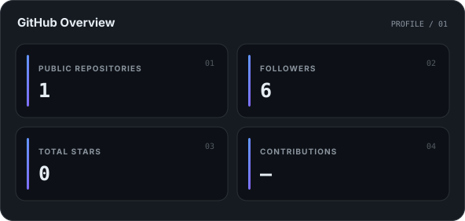
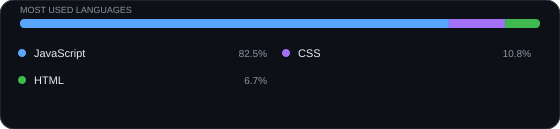
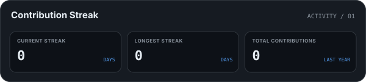

<!-- PROFILE-GENERATOR:START -->

<!-- Generated automatically. Edit config.yml instead. -->

<strong>Beginner Full-Stack Developer</strong>

ComSci student from Thailand. Interested in web development, automation, and developer tools.

---

## 👨‍💻 About Me

- 🇹🇭 Based in Thailand
- 🎓 Computer Science student
- 💻 Interested in full-stack development
- ⚙️ Enjoy building tools and automation

---

## 🛠️ Tech Stack

### Languages

### Frontend

### Backend &amp; Database

### Tools

---

## 📊 GitHub Statistics

### 🔥 Contribution Streak

---

## 🎮 Discord

---

## 🔗 Connect

  

---

<i>Code • Learn • Build • Improve</i>

<!-- PROFILE-GENERATOR:END -->