<!-- Typing Header Animation -->

  

  <strong>Beginner Full-Stack Developer</strong>

  I enjoy coding in my free time and building projects that improve my daily life. 
  I’m always learning new technologies and improving my development skills.

⸻

👨‍💻 About Me

* 🎓 Student: ComSci Student
* 📍 Location: Thailand
* 💻 Role: Beginner Full-Stack Developer
* 🖥️ OS: Windows 11 User
* ⚙️ Interest: Developer tools, automation, web development
* ✨ Learning: Always improving and exploring new technologies

⸻

🛠️ Tech Stack

Languages

  

Frontend

  

Backend

  

Database

  

Tools

  

⸻

---

## 📊 GitHub Statistics

<picture>
  <source media="(prefers-color-scheme: dark)"
          srcset="./assets/overview.dark.svg">
  
</picture>

---

## 🔥 Contribution History

<picture>
  <source media="(prefers-color-scheme: dark)"
          srcset="./assets/contributions.dark.svg">
  
</picture>

---

## 📈 Lifetime Contributions

<picture>
  <source media="(prefers-color-scheme: dark)"
          srcset="./assets/lifetime.dark.svg">
  
</picture>

---

## 💻 Most Used Languages

<picture>
  <source media="(prefers-color-scheme: dark)"
          srcset="./assets/languages.dark.svg">
  
</picture>

---

## ⚡ Contribution Momentum

<picture>
  <source media="(prefers-color-scheme: dark)"
          srcset="./assets/momentum.dark.svg">
  
</picture>

⸻

🎮 Discord Presence

  

⸻

🔗 Connect

  
  
  
  

⸻

  <i>Code • Learn • Build • Improve</i>

